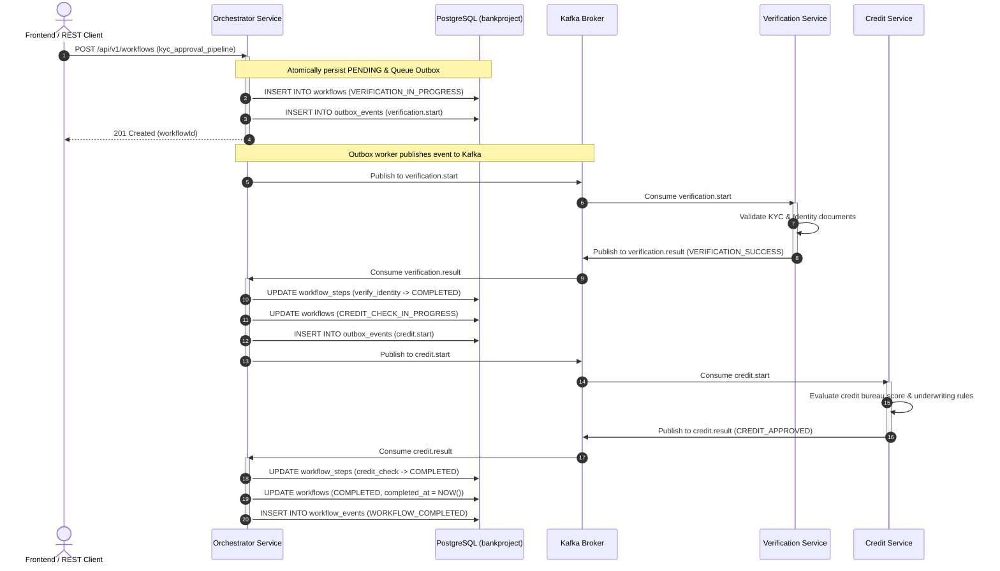
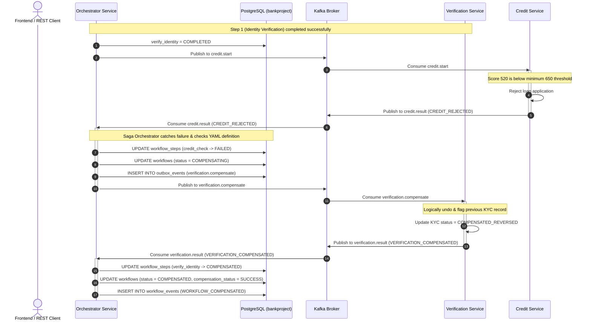

# FlowMaster Saga Orchestration & Compensation Workflows

This document specifies the Saga state transitions, compensation logic, and failure handling mechanisms implemented in FlowMaster.

---

## 1. Saga Sequence Diagram

### A. Success Path (Full Loan Approval)

---

### B. Failure & Compensation Rollback Path (Credit Rejected)

---

## 2. Saga State Machine Definitions

| Status | Category | Description |
|---|---|---|
| `PENDING` | Initial | Workflow submitted and awaiting initial outbox dispatch. |
| `VERIFICATION_IN_PROGRESS` | Running | Step 1 event dispatched to Kafka; awaiting verification worker. |
| `CREDIT_CHECK_IN_PROGRESS` | Running | Step 1 succeeded; Step 2 dispatched to credit service. |
| `COMPENSATING` | Rollback | Downstream failure detected; rollback events dispatched in reverse order. |
| `COMPLETED` | Terminal Success | All pipeline steps executed successfully; loan approved. |
| `FAILED` | Terminal Failure | Step 1 failed directly without requiring prior step compensation. |
| `COMPENSATED` | Terminal Rollback | Prior steps successfully reversed/flagged; data consistency maintained. |
| `RECOVERY_REQUIRED` | Administrative Alert | Compensation action itself failed; flagged for manual/operator triage. |

---

## 3. Distinction Between Failure Types

1. **Business Rejection**:
   - Customer fails underwriting eligibility (e.g. credit score < 650, low income).
   - Expected business outcome: triggers Saga compensation rollback of prior completed steps.
2. **Transient Technical Error**:
   - Network timeout, 504 Gateway Timeout, broker disconnection.
   - Handled via BullMQ exponential backoff retries and circuit breaker fast-failing.
3. **Compensation Failure**:
   - The compensation action itself fails (e.g. KYC registry unavailable during rollback).
   - Workflow transitions to `RECOVERY_REQUIRED` with `compensation_status = FAILED`.
   - Never falsely marks as compensated.
